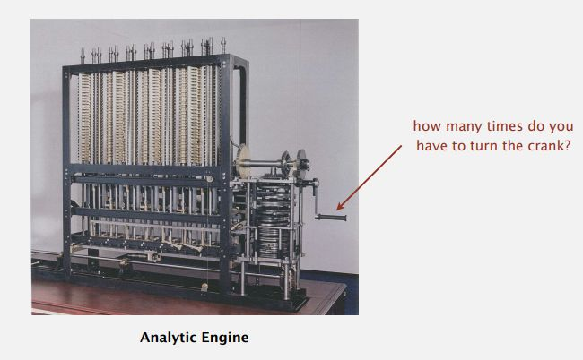
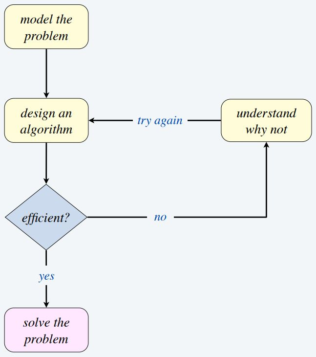
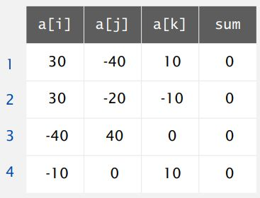
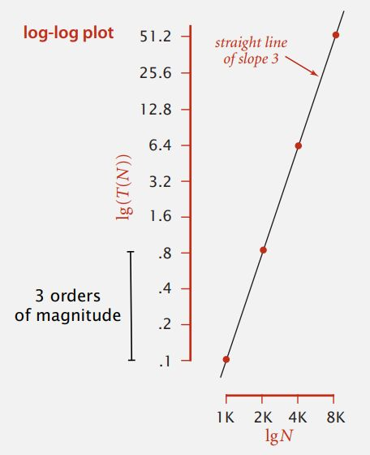
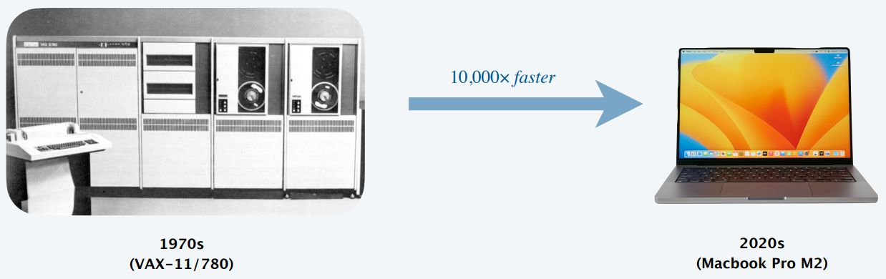
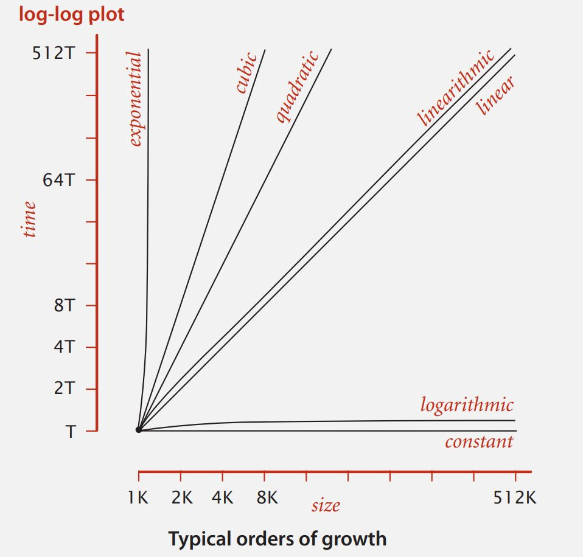
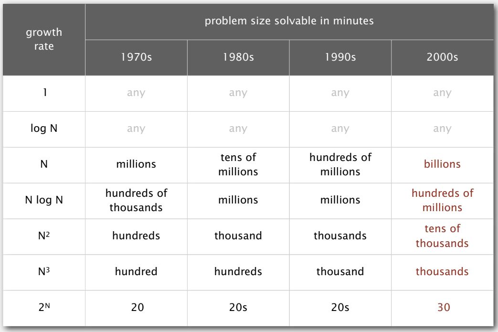

## Algorithms: solving problems with computation {data-timing="30"}

### Ideas that shape what programs—and science—can do

Stanislav (Stanley) Modrak  
Draft MQB adaptation for contributor review

After Robert Sedgewick and Kevin Wayne, *Algorithms*, 4th edition  
[Section 1.4: Analysis of Algorithms](https://algs4.cs.princeton.edu/14analysis/)

::: notes
00:00–00:30. The deck is a draft adaptation of Stanislav Modrak's original
lecture, itself adapted from teaching by Robert Sedgewick and Kevin Wayne. Open
with the wider idea: algorithms affect what can be expressed, investigated and
solved—not only how quickly one program runs.
:::

## The question {data-timing="90"}

Suppose we have a scientific problem and a program that appears to solve it.

**Is this a good way to solve the problem—and what might a better algorithm
make possible?**

We will consider:

1. correctness, assumptions and clarity;
2. data structures and alternative procedures;
3. measurements and models of how work grows; and
4. the scientific and wider consequences of algorithmic choices.

::: notes
00:30–02:00. Begin from a practical scientific decision. A successful run on a
small example establishes neither correctness for every input nor that the
problem has been formulated well. Performance is one part of the comparison,
not the definition of a good algorithm.
:::

## Where this fits in the MQB workflow {data-timing="120"}

**Plan → implement → test → profile → analyse → improve → explain → rerun**

- Testing asks whether observed behaviour agrees with an independently expected result.
- Profiling asks where a particular run spent its time.
- Algorithm analysis asks how the required work changes with input size.

**Correctness comes first.** A fast wrong answer is still wrong—just sooner.

::: notes
02:00–04:00. Connect to the MQB habits already developed in shell, Python and R.
Do not present algorithm analysis as a replacement for testing or profiling. An
improvement must retain the program's specified behaviour, and the comparison
therefore needs common correctness checks.
:::

## Why study algorithms? {.smaller data-timing="150"}

- **To solve problems that could not otherwise be addressed.** A different
  formulation can remove enormous amounts of unnecessary work.
- **To become a proficient programmer.** Syntax helps us express a solution;
  algorithms help us decide whether it is a sensible solution.
- **For intellectual stimulation.** Some people relax with crosswords. Others
  try to remove a factor of $n$. We shall not judge either group.

::: notes
04:00–06:30. Restore the breadth of the original motivation before introducing
performance. Proficiency includes problem formulation, choice of representation
and the ability to explain why a procedure works—not simply fluency in syntax.
:::

## Algorithms go rather a long way {.smaller data-timing="150"}

:::: columns
::: {.column width="55%"}

- **Their impact is broad and far-reaching:** science, transport, medicine,
  communication, finance and everyday life online.
- **They may unlock the secrets of life—and perhaps the universe.** It seems
  polite to give both a well-specified algorithm and a proper test.
- **For profit.** Search, routing, recommendation and trading algorithms have
  done rather well. Profit is not, however, evidence of scientific validity or
  social virtue.

:::
::: {.column width="45%"}

{width="98%"}

:::
::::

::: notes
06:30–09:00. Retain the scientific, intellectual and commercial motivations
from the original lecture. Invite students to add an example of an algorithm
that has changed a field or an everyday activity. The image is an extracted
original asset; attribution and reuse need confirmation during review.
:::

## Two ideas we need {data-timing="150"}

**Algorithm:** a precise sequence of steps for solving a specified problem.

**Data structure:** a way of organising data so that useful operations can be carried out.

The same problem may have several correct algorithms. Their choice of data
structure can change how much work they require.

::: notes
09:00–11:30. Readers may already have used lists, dictionaries, sets and data
frames. Make the connection explicit: these are not interchangeable containers.
Their supported operations and costs shape possible algorithms.
:::

## A long history, not a new fashion {.smaller data-timing="90"}

:::: columns
::: {.column width="52%"}

{width="90%"}

:::
::: {.column width="48%"}

Long before electronic computers, people were already asking:

- Which operations must be performed?
- How many times must each operation be repeated?
- Can the procedure be reorganised?

:::
::::

::: notes
11:30–13:00. This retains the historical motivation from the original deck
without relying on its exact machine-operation quotation. The extracted image
is retained with the other source assets pending provenance review.
:::

## Algorithms can change what science is feasible {data-timing="180"}

- Genome assembly became tractable through graph-based representations and
  algorithms that avoid comparing every possible reconstruction.
- Ecological null models and simulations can often reuse quantities that have
  not changed instead of recalculating the entire state.

The important claim is not one universal complexity for either field. It is
that **reformulating the computation can remove enormous amounts of repeated work**.

::: notes
13:00–16:00. The source deck gives simplified linear-versus-quadratic examples
for genome and community assembly. Those are useful motivations but too broad as
general complexity claims. Keep the scientific examples while stating the
mechanism modestly. Ask Stanislav to supply a precise reference if a numerical
complexity claim is restored.
:::

## Develop the evidence in the right order {data-timing="150"}

{height="470"}

**Problem → algorithm → implementation → measurement → model**

::: notes
16:00–18:30. An implementation mixes the algorithm with language, libraries,
hardware and operating-system effects. We need it for experiments, but we should
not mistake its measured time for a universal property of the algorithm.
:::

## Worked example: 3-SUM {data-timing="150"}

Given a collection of **distinct integers**, how many triples sum to exactly zero?

{height="300"}

For `30, -40, -20, -10, 40, 0, 10, 5`, the expected answer is **4**.

::: notes
18:30–21:00. Establish the input assumptions and expected result before code.
The original example says the integers are distinct; retain that condition
because it matters when deciding what counts as a different triple.
:::

## A transparent brute-force algorithm {.smaller data-timing="180"}

```python
def count_three_sum(values: list[int]) -> int:
    """Count index triples whose values sum to zero."""
    n = len(values)
    count = 0
    for i in range(n):
        for j in range(i + 1, n):
            for k in range(j + 1, n):
                if values[i] + values[j] + values[k] == 0:
                    count += 1
    return count
```

**Before timing it:** which test would persuade you that it counts the intended triples?

::: notes
21:00–24:00. Walk through why the increasing indices avoid permutations and
reusing one element. Ask for a small hand-worked test. Correctness checks should
be shared by every later implementation.
:::

## What does input size mean here? {data-timing="120"}

Let $n$ be the number of integers.

The running time is a function $T(n)$, but it can also depend on:

- the actual values in the input;
- the Python implementation and libraries;
- the processor, memory and cache;
- the operating system and other work on the machine.

So how can we measure it sensibly?

::: notes
24:00–26:00. Define n explicitly. Avoid saying that the algorithm alone always
determines the exponent and the input only determines a coefficient; some
algorithms have input-dependent best, average and worst cases.
:::

## When should we optimise? {data-timing="60"}

> “Premature optimization is the root of all evil.”
>
> — Donald Knuth, [*Structured Programming with go to
> Statements*](https://doi.org/10.1145/356635.356640), 1974

**What does this warning *not* mean?**

::: notes
26:00–27:00. It does not mean that performance is unimportant. Knuth is warning
against small, speculative efficiencies before we have a correct solution and
evidence about the real cost. Make the problem precise, test the result, then
measure. This leads directly into the timing method.
:::

## Measure before you model {.smaller data-timing="150"}

```python
from statistics import median
from time import perf_counter

def elapsed_seconds(function, argument, repetitions=5):
    function(argument)  # untimed warm-up
    times = []
    for _ in range(repetitions):
        start = perf_counter()
        function(argument)
        times.append(perf_counter() - start)
    return median(times)
```

- Use several input sizes.
- Repeat timings and report the median.
- Time equivalent work and record the environment.
- Check the result as well as the clock.

::: notes
27:00–29:30. This strengthens the source deck's single-run perf_counter example.
perf_counter is appropriate for elapsed-duration measurements. A warm-up and
median do not remove all noise, but they are a defensible classroom baseline.
Do not include file reading or printing when comparing only the algorithm.
:::

## What pattern do the measurements suggest? {data-timing="150"}

{height="470"}

If multiplying $n$ by 2 multiplies time by about 8, that is evidence
consistent with cubic growth because $2^3 = 8$.

::: notes
29:30–32:00. Ask students to predict the multiplier before revealing it. The
plot is historical evidence from the source lecture, not a benchmark for their
machine. A log-log line can suggest a power law; it does not prove one.
:::

## A useful empirical model {data-timing="180"}

Suppose the measurements are consistent with

\[
T(n) \approx a n^b.
\]

Taking logarithms gives

\[
\log T(n) \approx \log a + b\log n.
\]

The slope $b$ describes the observed scaling over the measured range. The
coefficient $a$ absorbs machine- and implementation-dependent costs.

::: notes
32:00–35:00. This makes explicit the log transformation behind the original
regression slide. State the limitation: a fitted power law is an empirical model
over the tested sizes. Small inputs, cache boundaries or mixed operations can
produce a different pattern.
:::

## Faster hardware changes the coefficient—not the question {data-timing="150"}

{width="82%"}

A faster computer may reduce every measured time. It does not usually change
the number of triples examined by this algorithm.

**How long until growth in the input consumes the hardware gain?**

::: notes
35:00–37:30. The exact hardware comparison in the original figure is a period
illustration, not a current benchmark. The conceptual point remains useful:
constant-factor improvements cannot indefinitely compensate for a poor growth
rate.
:::

## From timings to a mathematical model {data-timing="150"}

In principle, running time is a sum of

\[
\text{frequency of an operation} \times \text{cost of that operation}.
\]

Exact costs are awkward and machine-dependent. Instead:

1. choose an operation that captures the main repeated work; and
2. count how often the algorithm performs it as $n$ grows.

::: notes
37:30–40:00. Do not use the source deck's old nanosecond table as if it were a
current universal measurement. Assignment, arithmetic, indexing and function
calls have different costs, and Python objects add overhead. We want a useful
model, not false precision.
:::

## A simple cost model: 1-SUM {.smaller data-timing="180"}

```python
def count_zeros(values: list[int]) -> int:
    count = 0
    for value in values:
        if value == 0:
            count += 1
    return count
```

If comparison with zero is the chosen operation, how many comparisons occur
for a list of length $n$?

**Exactly $n$**—whether the list contains no zeroes or many.

::: notes
40:00–43:00. The source calls this 1-SUM. Use a descriptive function name while
retaining the example. Students should identify the comparison as the counted
operation. Other operations matter to elapsed time, but they also grow linearly.
:::

## Keep the part that governs growth {data-timing="180"}

Suppose an operation count is

\[
4n^3 + 2n^2 + 16.
\]

For large $n$, the $n^3$ term dominates. We therefore describe the growth as

\[
\Theta(n^3).
\]

This discards the leading coefficient and lower-order terms—not because they
never matter, but because the model is asking how the work scales.

::: notes
43:00–46:00. Correct the original line that said small n does not matter.
Constants and lower-order terms can decide which implementation is faster for
the input sizes we actually use. Asymptotic notation addresses the large-input
trend.
:::

## Big Theta and Big O are not interchangeable {data-timing="180"}

- $\Theta(g(n))$: a **tight** asymptotic growth class—both an upper and lower bound.
- $O(g(n))$: an asymptotic **upper bound**.

If an algorithm takes $\Theta(n)$ work, it is also $O(n^2)$, but $O(n^2)$
does not describe it tightly.

In informal conversation people often say “Big O” when they mean order of
growth. Here we will use $\Theta$ when claiming a tight class.

::: notes
46:00–49:00. This resolves the source deck's mixture of Big Theta and Big O.
Do not turn this into a proof course. Students need to interpret and
compare growth classes accurately.
:::

## Common orders of growth {.smaller data-timing="210"}

{height="520"}

::: notes
49:00–52:30. Read the plot from left to right. Linear and n log n algorithms
often remain useful at much larger n than quadratic or cubic ones. That is a
guide, not a universal runtime ranking: coefficients, libraries and input size
still matter.
:::

## What happens when the input doubles? {.smaller data-timing="180"}

| Growth | Approximate multiplier when $n\rightarrow2n$ |
|:--|--:|
| $1$ | 1 |
| $\log n$ | slightly more than 1 |
| $n$ | 2 |
| $n\log n$ | a little more than 2 |
| $n^2$ | 4 |
| $n^3$ | 8 |
| $2^n$ | squares its previous value |

**Predict first:** which pattern should the triple loop show?

::: notes
52:30–55:30. This is a practical way to connect experiments with asymptotic
classes. Doubling ratios are approximate when lower-order terms and overheads
are visible.
:::

## Break {data-timing="600"}

When we return: can a different data structure turn a quadratic algorithm into
a linear one?

::: notes
55:30–65:30. Ten-minute break.
:::

## Worked comparison: 2-SUM {data-timing="120"}

Given a collection of **distinct integers**, count the pairs whose sum is zero.

Before seeing code:

- What result do you expect for `[3, -3, 5, 8, -8]`?
- What should happen for an empty list?
- Why does “distinct integers” matter?

::: notes
65:30–67:30. Expected answer is two pairs. Ask students to state whether pairs
refer to values or indices. The distinct-value assumption lets the simple set
algorithm below count each complementary pair once.
:::

## Approach 1: compare every pair {.smaller data-timing="180"}

```python
def count_two_sum_brute(values: list[int]) -> int:
    count = 0
    n = len(values)
    for i in range(n):
        for j in range(i + 1, n):
            if values[i] + values[j] == 0:
                count += 1
    return count
```

The number of comparisons is

\[
\frac{n(n-1)}{2},
\]

so the running time is $\Theta(n^2)$.

::: notes
67:30–70:30. Ask why j begins at i+1. Expand n(n-1)/2 only as far as needed to
see the n-squared leading term.
:::

## Approach 2: remember what we have seen {.smaller data-timing="210"}

```python
def count_two_sum_set(values: list[int]) -> int:
    seen: set[int] = set()
    count = 0
    for value in values:
        if -value in seen:
            count += 1
        seen.add(value)
    return count
```

With average constant-time set lookup and insertion:

- expected running time: $\Theta(n)$;
- additional memory: $\Theta(n)$.

::: notes
70:30–74:00. Trace one pair. Make the assumption explicit: Python set lookup is
average constant time, not an unconditional worst-case guarantee. This approach
trades memory for speed.
:::

## Same answer? Check before celebrating {data-timing="180"}

```python
examples = [
    ([], 0),
    ([4], 0),
    ([3, -3, 5, 8, -8], 2),
    ([-10, -2, 0, 6, 10], 1),
]

for values, expected in examples:
    assert count_two_sum_brute(values) == expected
    assert count_two_sum_set(values) == expected
```

These checks support the stated **distinct-integer** problem. They do not show
that the set version counts every index pair correctly when values repeat.

::: notes
74:00–77:00. This limitation is deliberate. For example, repeated zeroes or
multiple copies of a complementary value require a frequency-aware algorithm if
the task is to count index pairs. Performance comparisons are meaningless when
the implementations solve different problems.
:::

## Practical: predict, test and explain scaling {.smaller data-timing="900"}

In pairs:

1. Copy the two 2-SUM functions into a fresh script.
2. Add the shared correctness checks.
3. Predict the growth class of each implementation and the effect of doubling $n$.
4. Generate distinct inputs of several sizes with known or independently checked answers.
5. After one warm-up, record the median of at least five timings for each size.
6. Decide whether the evidence agrees with your prediction.

Record the environment and time only the pair-counting function—not input
generation, printing or plotting.

::: notes
77:00–92:00. Give students fifteen minutes. Provide a prepared timing table if
machines or setup fail. Discourage very large brute-force inputs. The goal is to
connect a prediction to evidence, not to freeze the room for the longest run.
:::

## Practical debrief {data-timing="300"}

Be ready to explain:

- whether both functions passed the same checks;
- how elapsed time changed when $n$ doubled;
- why the set changes the amount of repeated work;
- what extra memory the faster algorithm uses; and
- one limitation of your measurement.

::: notes
92:00–97:00. Invite two comparisons, preferably including one noisy result.
Treat disagreement as a reason to inspect input sizes, repetitions and timed
work rather than as failure.
:::

## Memory is part of performance {data-timing="180"}

Ask how the largest amount of memory held at one time grows with $n$.

- The brute-force 2-SUM loop uses little additional memory: $\Theta(1)$.
- The set-based algorithm stores up to $n$ values: $\Theta(n)$.

The faster algorithm is not free. It exchanges memory for fewer comparisons.

::: notes
97:00–100:00. This develops the source deck's brief memory slide into an
explicit time-memory trade-off. Distinguish additional working memory from the
memory already occupied by the input.
:::

## Improve the algorithm before buying hardware {data-timing="150"}

{height="465"}

A change from $\Theta(n^2)$ to expected $\Theta(n)$ can save orders of magnitude.
Adding processors usually changes performance by a bounded factor.

::: notes
100:00–102:30. Use the original table qualitatively; its exact solvable sizes
depend on operation cost and hardware. The ordering is the lesson.
:::

## Parallelism and HPC: the next layer {data-timing="180"}

**Parallelism** performs independent operations at the same time.

**High-performance computing (HPC)** provides larger or specialised resources—such as many CPU cores, GPUs or high-memory nodes—for suitable workloads.

- Independent simulations or parameter combinations may parallelise well.
- Steps that depend on previous results remain sequential.
- Coordination and data movement also cost time.

**Choose a suitable algorithm first; then ask whether parallel hardware helps.**

::: notes
102:30–105:30. Keep this conceptual. Operational HPC guidance belongs in the
performance and HPC appendices and remains under separate MQB review. Avoid
implying that moving code to a cluster automatically makes it faster.
:::

## What should you now be able to do? {data-timing="150"}

Given two implementations of the same problem, you should be able to:

1. explain why the algorithmic choice matters;
2. state the input, output and assumptions;
3. check that both produce the intended result;
4. measure comparable runs over several input sizes;
5. predict and explain their orders of growth;
6. identify a time-memory trade-off; and
7. justify which implementation you would use.

::: notes
105:30–108:00. Return to the opening question. The answer is not simply “use the
fastest”. It depends on correctness, expected input sizes, memory, clarity and
how often the work will be repeated.
:::

## From an algorithm to evidence {data-timing="120"}

A clean notebook can present:

- the problem and assumptions;
- the shared correctness checks;
- the timing method and results;
- the predicted and observed scaling; and
- your reason for accepting or rejecting any suggested improvement.

The notebook explains the evidence. The reusable functions still belong in a
script that can be tested independently.

::: notes
108:00–110:00. Connect the conceptual comparison to a reproducible scientific
account. If an AI tool proposes a change, it must be tested against the
independent baseline established before assistance.
:::

## Sources and review status {.smaller data-timing="60"}

This draft adapts:

> Stanislav (Stanley) Modrak, *Analysis of algorithms*, adapted from Robert
> Sedgewick and Kevin Wayne, *Algorithms*, 4th edition (Addison-Wesley, 2011),
> especially [Section 1.4: Analysis of
> Algorithms](https://algs4.cs.princeton.edu/14analysis/) and its [Princeton
> lecture slides](https://algs4.cs.princeton.edu/lectures/keynote/14AnalysisOfAlgorithms.pdf).

The MQB redraft retains the broad motivations while adding explicit
correctness checks, repeated timing and clearer time-memory trade-offs.

**Before release:** review the visual provenance, permissions and teaching fit.

::: notes
110:00–111:00. Use any remaining time for questions, unfinished practical work
and discussion. Do not present this draft as approved or published material.
:::
